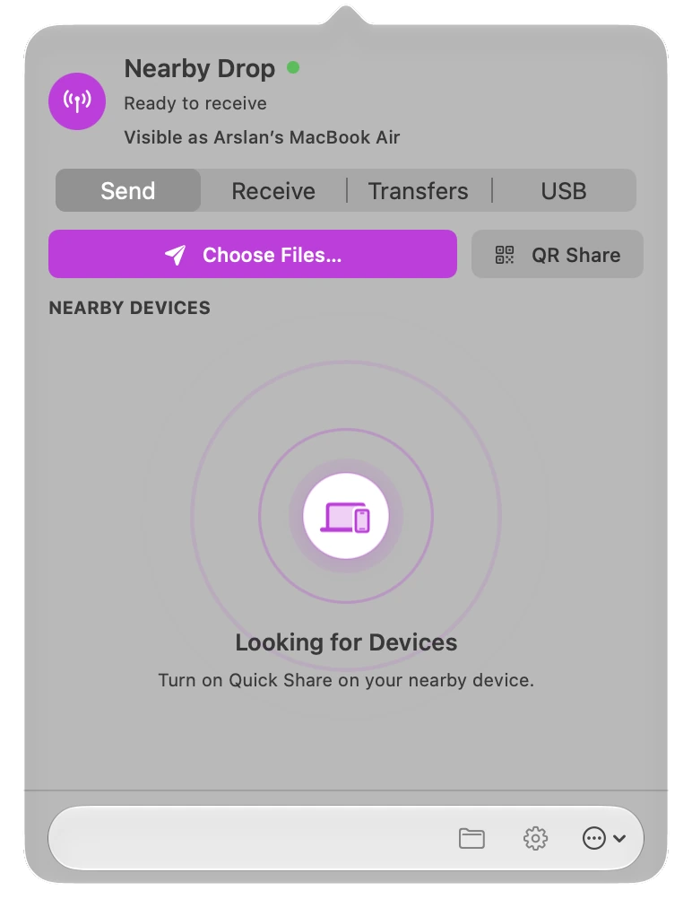

# Nearby Drop

Nearby Drop is a native macOS menu bar app for two-way file sharing between Mac and Android with Quick Share, QR codes, and USB MTP. It also supports compatible Windows Quick Share clients and Finder sharing.

  
  
  
  

**[Website](https://arslanbasharat-o-o.github.io/NearByDrop/)** · **[Download](https://github.com/arslanbasharat-o-o/NearByDrop/releases/latest)** · [Guides](https://arslanbasharat-o-o.github.io/NearByDrop/#guides) · [Report a problem](https://github.com/arslanbasharat-o-o/NearByDrop/issues) · [Contributing](CONTRIBUTING.md)

Send over Wi-Fi, scan or show a QR code, connect by USB, or share from Finder.

## Screenshots

| Receive | Send |
| :---: | :---: |
|  |  |

## Similar names

This GitHub repository is named **NearByDrop**; the app is branded **Nearby Drop**. It is separate from [NearDrop by grishka](https://github.com/grishka/NearDrop). See the [sourced comparison of the two Mac apps](https://arslanbasharat-o-o.github.io/NearByDrop/blog/neardrop-vs-nearby-drop.html).

## Pick your path

| Quick Share | QR codes | USB MTP | Finder |
| --- | --- | --- | --- |
| Send and receive files over a reachable local network. | Scan a phone’s code in the app, or show a code for the phone to scan. | Browse Android storage and move files over a cable. | Share files, folders, and links from the Finder menu. |

## Track and manage transfers

- **Progress:** Follow transfer direction, status, progress, speed, and estimated time remaining.
- **History:** Review recent incoming and outgoing items, including their file, device, size, and time. Open a saved item in Finder.
- **USB MTP:** Browse Android storage and upload or download files and folders over a cable.
- **Settings:** Choose the download folder, appearance, accent color, launch-at-login, sound, and haptic feedback.
- **Trusted devices:** Manage devices that can accept transfers automatically.
- **Updates:** Check for new versions from the About screen and install an available update from the app.

## Transfer guides

- [Receive Android files on a Mac with Quick Share or USB MTP](https://arslanbasharat-o-o.github.io/NearByDrop/blog/how-to-transfer-files-mac-android.html)
- [Send files from a Mac to Android with Quick Share](https://arslanbasharat-o-o.github.io/NearByDrop/blog/mac-to-android-quick-share.html)
- [Compare Android-to-Mac file transfer options](https://arslanbasharat-o-o.github.io/NearByDrop/blog/airdrop-alternative-for-android.html)
- [Use Quick Share between Mac and Windows](https://arslanbasharat-o-o.github.io/NearByDrop/blog/quick-share-mac-windows.html)
- [Compare NearDrop and Nearby Drop](https://arslanbasharat-o-o.github.io/NearByDrop/blog/neardrop-vs-nearby-drop.html)

## Install Nearby Drop

1. [Download the latest DMG](https://github.com/arslanbasharat-o-o/NearByDrop/releases/latest).
2. Open it and drag **Nearby Drop** into **Applications**.
3. Open the app from the menu bar.

The app supports macOS 14 or newer on Apple silicon and Intel. Releases are currently ad hoc signed, so macOS may ask you to approve the first launch in **System Settings → Privacy & Security**.

Starting with version 2.3.3, the app checks for updates at launch and hourly. When one is ready, choose **Update & Restart** from the menu or About page. Versions 2.3.2 and earlier need one manual update to 2.3.3 first.

## Send and receive

- **Mac to phone or PC:** Open **Send**, choose files, then select a nearby device. Both devices need to be on a reachable local network.
- **Phone to Mac:** Choose files on the phone and share with Quick Share. Accept the request in Nearby Drop, unless that device is trusted for automatic acceptance.
- **QR:** Use **Receive → Scan QR Code** to scan a phone’s Quick Share code. Choose **QR Share** to show a code from the Mac.
- **USB:** Connect and unlock the phone, choose **File transfer / Android Auto** in its USB prompt, then open the **USB** tab.
- **Finder:** Select items, open the Share menu, and choose **Nearby Drop**.

## What has been tested

| Connection | Result |
| --- | --- |
| Pixel 8 Pro ↔ Mac over local Wi-Fi | File transfer and both QR directions were manually confirmed. |
| One Windows PC ↔ Mac | Both directions passed with the Google Quick Share app in a development build; the packaged release was not separately device-tested. |
| Android USB MTP | Browse, upload, and download passed with Pixel and Nexus devices. |
| Phone hotspot using LTE | Not verified; use a shared Wi-Fi network or USB if discovery does not work. |

See [device verification notes](docs/DEVICE-VERIFICATION.md) for the tested scope and limitations. Results on one device do not guarantee compatibility with every Android phone or Windows PC.

## Network and privacy

- Both devices need a reachable local network. Guest Wi-Fi and client isolation can block discovery.
- Wireless Quick Share sessions are encrypted. Files travel directly between devices; Nearby Drop does not relay them through a cloud service. USB MTP uses the connected cable.
- The app contacts GitHub to check for signed updates. It does not send transfer history or personal files.
- Quick Share is a Google trademark. Nearby Drop is independent and is not affiliated with Google or Apple.

## For developers

See [Contributing](CONTRIBUTING.md) for the universal release build and automated test commands. Protocol notes are in [PROTOCOL.md](PROTOCOL.md); USB library notices and source details are in [Vendor/USB](Vendor/USB/README.md).

## License

Nearby Drop is free to download and proprietary. Third-party components retain their own licenses; see [LICENSE](LICENSE) and [Vendor/USB](Vendor/USB/README.md).
