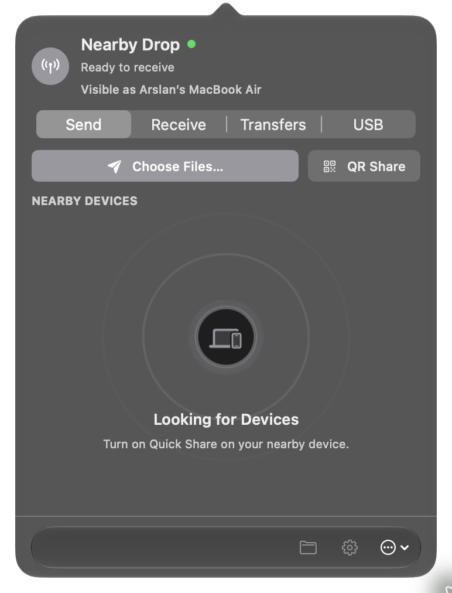
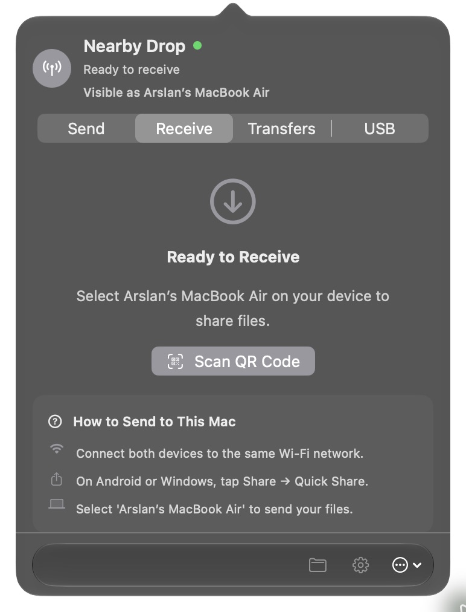
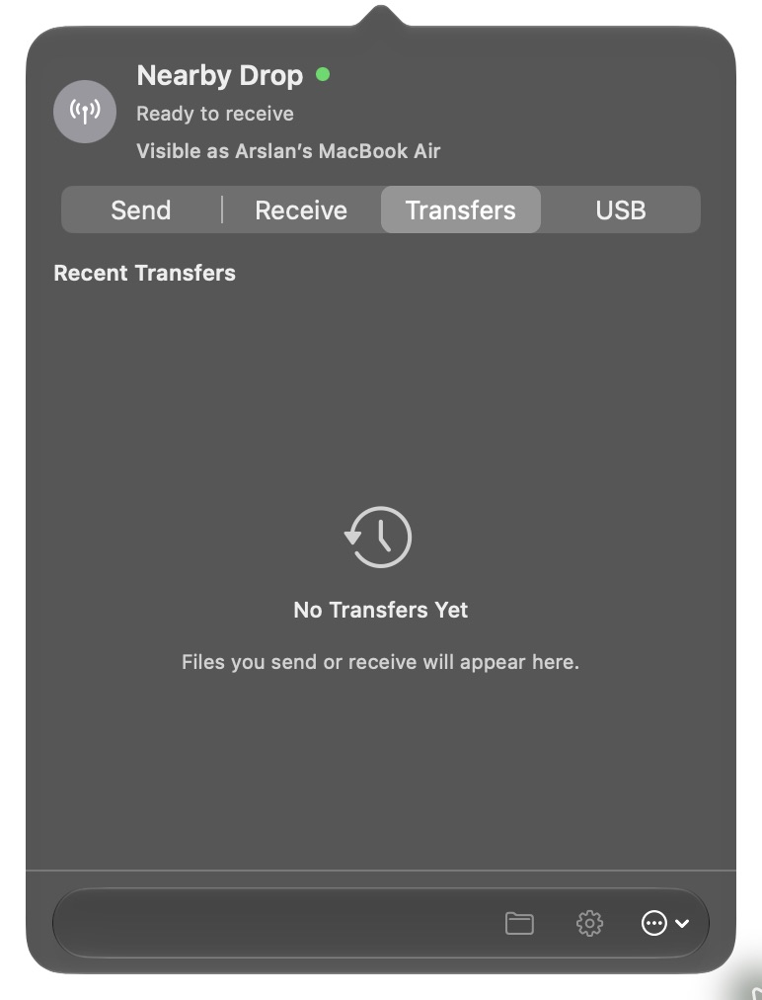
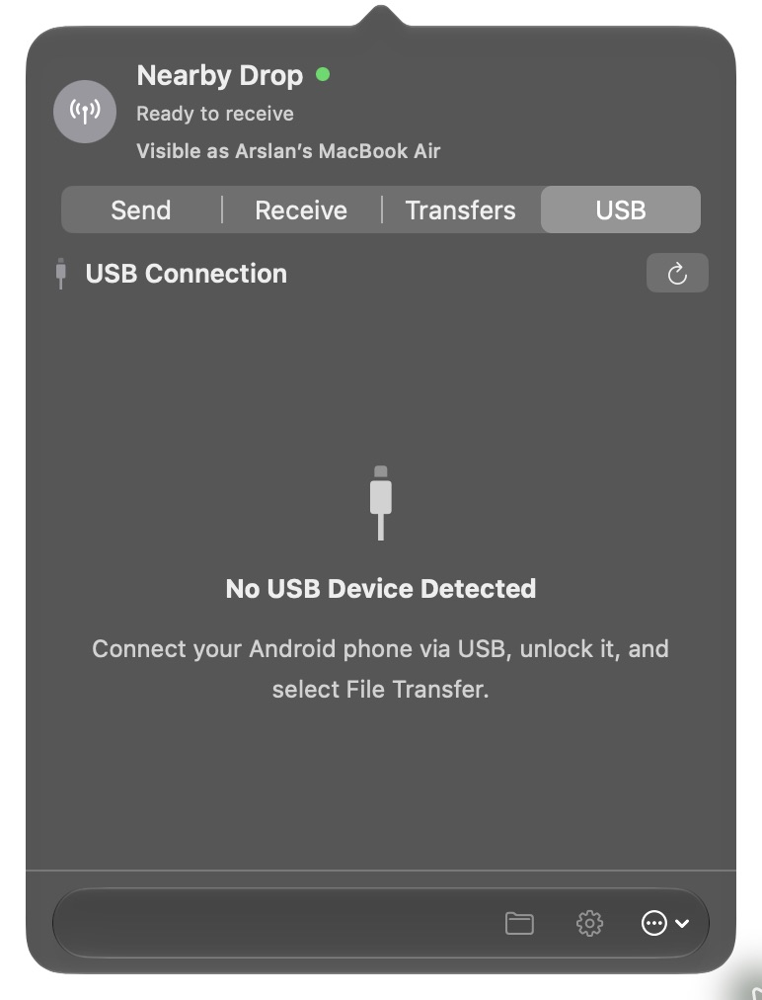

<h1 align="center">Nearby Drop</h1>

  
  
<strong>Quick Share between your Mac and Android.</strong> Wi-Fi, QR, or USB. Compatible Windows clients are supported too.

  

    <a href="https://github.com/arslanbasharat-o-o/NearByDrop/releases/latest"><strong>Download for Mac</strong></a> ·
    <a href="https://arslanbasharat-o-o.github.io/NearByDrop/">Website & setup</a> ·
    <a href="https://github.com/arslanbasharat-o-o/NearByDrop/releases">Release notes</a>
  

  

    
    
    
  

<table align="center">
  <tr>
    <td width="50%" align="center"><strong>Send</strong> </td>
    <td width="50%" align="center"><strong>Receive</strong> </td>
  </tr>
  <tr>
    <td width="50%" align="center"><strong>Transfers</strong> </td>
    <td width="50%" align="center"><strong>USB</strong> </td>
  </tr>
</table>

Nearby Drop is an independent macOS menu bar app. It is not affiliated with Google or Apple.

## Install

Download the [latest DMG](https://github.com/arslanbasharat-o-o/NearByDrop/releases/latest), drag Nearby Drop to **Applications**, then open it. Requires **macOS 14 or newer**.

The app is ad hoc signed, not notarized. If macOS blocks it, open it once and approve it in **System Settings → Privacy & Security**. Keep Gatekeeper enabled.

## Send files

- **Android → Mac:** Put both devices on reachable Wi-Fi. Leave Nearby Drop on **Receive**, then select this Mac in Quick Share and accept the transfer. Scan a QR code if discovery fails.
- **Mac → Android:** In **Send**, choose files and select the Android device. Accept on the phone.
- **USB:** Unlock the phone, choose **File transfer**, connect a data cable, then use the **USB** tab.

Nearby Drop also supports Finder sharing, transfer history, and signed in-app updates. Windows Quick Share was tested with one PC; see the [device verification record](docs/DEVICE-VERIFICATION.md).

## Privacy

Wireless transfers go directly over your local network; Nearby Drop does not relay files through its own cloud service. Incoming transfers need your approval unless you trust that device. Diagnostic reports are on by default in configured builds and can be disabled in Settings. They include first launch and app opens (hour-rounded), a random installation ID, app and macOS versions, Mac hardware model, your Mac's advertised name, and the other device's advertised name and broad type after a successful wireless transfer. They never include file names, file contents, or device IDs. See the [privacy policy](https://arslanbasharat-o-o.github.io/NearByDrop/legal/privacy.html).

## Help

[Setup and FAQs](https://arslanbasharat-o-o.github.io/NearByDrop/) ·
[Report a bug](https://github.com/arslanbasharat-o-o/NearByDrop/issues) ·
[Security policy](SECURITY.md)

When reporting a bug, include the app and macOS versions, Mac type, phone model, and connection method. Do not post personal files, credentials, or active pairing codes.

## Project

[Contributing](CONTRIBUTING.md) · [Protocol notes](PROTOCOL.md) · [License](LICENSE) · [Third-party notices](Vendor/USB/README.md)

Nearby Drop is proprietary software, free to download. Quick Share is a Google trademark.
