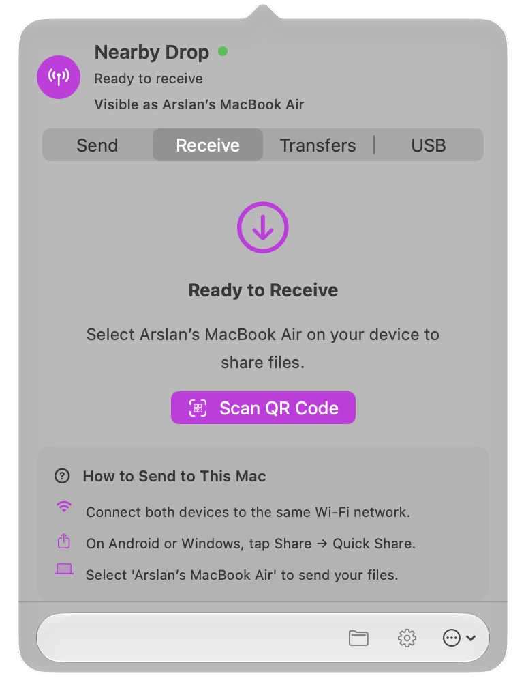
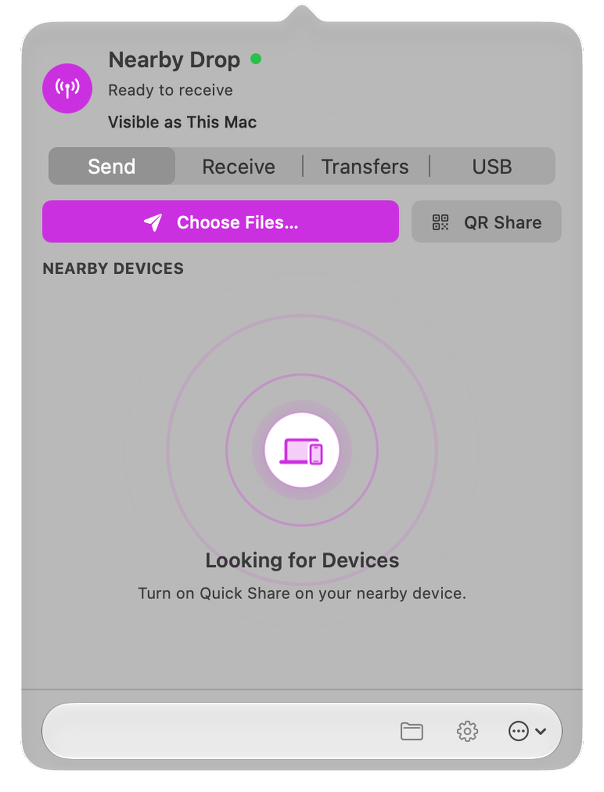
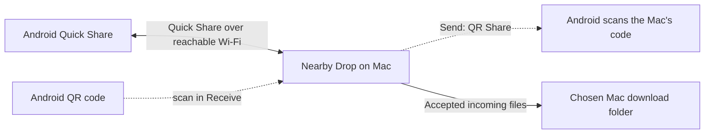
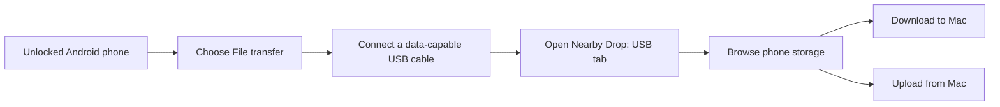

# Nearby Drop

<div align="center">
  
  <p><strong>Quick Share between your Mac and Android.</strong><br />Use Wi-Fi, scan a QR code, or connect with USB. Compatible Windows Quick Share clients are supported too.</p>
  <p>
    <a href="https://github.com/arslanbasharat-o-o/NearByDrop/actions/workflows/build.yml"></a>
    <a href="https://github.com/arslanbasharat-o-o/NearByDrop/releases/latest"></a>
    
    
  </p>
  <p>
    <a href="https://github.com/arslanbasharat-o-o/NearByDrop/releases/latest"><strong>Download for Mac</strong></a> ·
    <a href="https://arslanbasharat-o-o.github.io/NearByDrop/">Website</a> ·
    <a href="#transfer-files">Getting started</a> ·
    <a href="https://github.com/arslanbasharat-o-o/NearByDrop/issues">Report an issue</a>
  </p>
</div>

Nearby Drop is a native macOS menu bar app for sending and receiving files with Quick Share-compatible devices. It also includes QR pairing, Android USB MTP, transfer history, and a Finder Share extension. Nearby Drop is independent and is not affiliated with Google or Apple.

## Screenshots

<div align="center">
  
  
</div>

<details>
  <summary>Contents</summary>

- [What Nearby Drop does](#what-nearby-drop-does)
- [How wireless and USB transfers work](#how-transfers-work)
- [Features](#features)
- [Compatibility and tested devices](#compatibility-and-tested-devices)
- [Install](#install)
- [Transfer files](#transfer-files)
  - [Android to Mac](#android-to-mac)
  - [Mac to Android](#mac-to-android)
  - [Mac and Windows](#mac-and-windows)
  - [QR pairing](#qr-pairing)
  - [USB MTP](#usb-mtp)
  - [Finder sharing](#finder-sharing)
- [Settings and transfer history](#settings-and-transfer-history)
- [Troubleshooting](#troubleshooting)
- [Privacy and security](#privacy-and-security)
- [Updates](#updates)
- [Guides and project documentation](#guides-and-project-documentation)
- [Developers](#developers)
- [Contributing](#contributing)
- [License and credits](#license-and-credits)

</details>

## What Nearby Drop does

Nearby Drop brings Quick Share-compatible wireless transfers to a Mac menu bar app. Send files from macOS to Android or compatible Windows clients, receive files on the Mac, or move files through a USB cable with Android's Media Transfer Protocol (MTP).

The app's **Send**, **Receive**, **Transfers**, and **USB** tabs keep these workflows together. Wireless transfers use a reachable local network; QR codes provide another way to start a Quick Share session when discovery is inconvenient.

## How transfers work

Wireless Quick Share transfers connect directly between nearby devices over the local network. Scanning a QR code starts pairing; the file transfer still uses the wireless connection. Incoming transfers require approval unless you have trusted that device.



For a cable transfer, Android must be unlocked and set to **File transfer**:



## Features

| Workflow | What it does |
| --- | --- |
| Quick Share | Send and receive files over a reachable local network with compatible Android and Windows clients. |
| QR pairing | Scan an Android Quick Share code to receive, or show a Mac QR code for an Android device to scan when sending. |
| USB MTP | Browse Android storage and upload or download files over a cable. |
| Send from Mac | Select files or folders in Nearby Drop and choose a nearby device. |
| Finder sharing | Send supported files and web links from a Share menu. Use the app's Send tab for folders. |
| Transfers | Follow progress, status, speed, and recent incoming or outgoing transfers. Open completed files in Finder. |
| Preferences | Set the Mac's visible name, download folder, appearance and accent, login behavior, sound, haptics, and trusted devices. |
| Updates | Check for a signed app update from the About screen or app menu. |

## Compatibility and tested devices

| Device or path | Requirement | Verified scope |
| --- | --- | --- |
| Mac | macOS 14 or newer; Apple silicon or Intel | Release packaging checks both `arm64` and `x86_64`. |
| Android Quick Share | A compatible Android device and reachable local Wi-Fi | Pixel 8 Pro: Mac-to-Android and Android-to-Mac transfers, plus QR pairing in both directions. |
| Android USB MTP | Unlocked phone, USB data cable, and File transfer mode | Browse, upload, and download passed with Pixel and Nexus devices. |
| Windows Quick Share | A compatible Windows Quick Share client on a reachable network | Both directions passed with one Windows PC in a development build. The packaged release was not separately device-tested on that PC. |
| Phone hotspot | Network must allow devices to reach each other | LTE-only hotspot discovery has not been verified. |

These are checks on specific devices, not a compatibility guarantee for every phone, PC, router, or network. See the [device verification record](docs/DEVICE-VERIFICATION.md) for details.

## Install

1. [Download the latest DMG](https://github.com/arslanbasharat-o-o/NearByDrop/releases/latest).
2. Open the DMG and drag **Nearby Drop** into **Applications**.
3. Open Nearby Drop from **Applications**. Its controls appear in the macOS menu bar.

> **First launch:** release builds are ad hoc signed. If macOS blocks the app, download it from the official GitHub release, try opening it once, then review the approval option under **System Settings → Privacy & Security**. Do not disable Gatekeeper.

The release is universal for Apple silicon and Intel Macs. The minimum supported version is macOS 14.

## Transfer files

### Android to Mac

1. Connect both devices to the same reachable Wi-Fi network.
2. Open Nearby Drop and leave the **Receive** tab ready.
3. On Android, select the files, choose **Share → Quick Share**, and select this Mac.
4. Review and accept the request in Nearby Drop. Transfers from a trusted device are accepted automatically.
5. Find received files in the selected download folder and in **Transfers**.

If the Mac does not appear, use [QR pairing](#qr-pairing) or check [discovery troubleshooting](#troubleshooting).

### Mac to Android

1. Turn on Quick Share on Android and keep the phone available to receive.
2. In Nearby Drop, open **Send** and choose **Choose Files…**. Select files or folders.
3. Select the Android device under **Nearby Devices**.
4. Accept the transfer on the phone if Quick Share asks.

You can also send a file or link from Finder with [Finder sharing](#finder-sharing), or use [QR pairing](#qr-pairing) if the phone is not discovered.

### Mac and Windows

Use the Google Quick Share client on Windows, with both devices on a reachable local network. On the Mac, select a nearby Windows device in **Send**; to send to the Mac, share from Windows with Quick Share and accept the request in Nearby Drop. One Windows PC passed both directions in a development build; the packaged release has not been separately device-tested on Windows.

### QR pairing

QR codes start a Quick Share connection; they do not upload files to a website or replace the local wireless transfer.

- **Android to Mac:** in Nearby Drop, choose **Receive → Scan QR Code**, then scan the code shown by Android Quick Share. Allow camera access when macOS asks.
- **Mac to Android:** in **Send**, choose **QR Share**, select the files in the picker, then scan the displayed code with Android Quick Share.

The Mac waits up to two minutes for an incoming connection after a QR scan. Scan again if that session expires.

### USB MTP

1. Unlock the Android phone and connect it with a USB data cable.
2. On the phone's USB prompt, choose **File transfer**. Keep the phone unlocked while browsing.
3. Open the **USB** tab in Nearby Drop and refresh the device list if needed.
4. Select the phone and storage, then browse its folders.
5. Select files to download to the Mac, or choose files on the Mac to upload to the phone.

If no storage appears, unlock the phone and confirm **File transfer** is selected. Close other Android transfer apps that may already be using the MTP connection.

### Finder sharing

In Finder, select one or more supported files and choose **Share → Nearby Drop**. For a web link, use the Share menu in an app that can share URLs. Select the nearby recipient in the share window. Finder sharing does not accept folders; send folders from the app's **Send** tab.

## Settings and transfer history

Open **Settings** from the menu bar popover. The settings window includes:

- **General:** Mac device name, download folder, launch at login, sound effects, and trackpad haptics.
- **Appearance:** System, light, or dark theme and an accent color.
- **Devices:** review or remove trusted devices that can receive transfers automatically.
- **About:** app version and update controls.

The **Transfers** tab shows recent incoming and outgoing activity. Select a completed item to open it in Finder. Transfer history is stored locally and can include a file name, size, direction, device name, time, and local file URL.

## Troubleshooting

| Problem | Try this |
| --- | --- |
| No wireless device appears | Put both devices on the same non-guest Wi-Fi. Router client isolation or multicast filtering can block discovery. Check macOS **Privacy & Security → Local Network** and Bluetooth permissions, and confirm Quick Share is available on the other device. |
| Android cannot find the Mac | Keep Nearby Drop open on **Receive**. If discovery still fails, scan the Android Quick Share code with **Receive → Scan QR Code**. QR pairing still needs a reachable network for the transfer. |
| QR scan does not start | Grant camera access in **System Settings → Privacy & Security → Camera**, scan a Quick Share QR code, and retry within the two-minute receive window. |
| USB phone or storage is missing | Unlock the phone, select **File transfer**, use a data-capable cable, refresh the USB list, and close other Android transfer apps. |
| A transfer waits for approval | Accept the request on the receiving device. Only trust a device you control; trusted devices bypass the incoming approval prompt. |
| Update cannot install | Finish or cancel the active transfer, then choose **Update & Restart** from the About screen. |

For network-specific cases, see the [Android-to-Mac setup guide](https://arslanbasharat-o-o.github.io/NearByDrop/blog/how-to-transfer-files-mac-android.html) and [device verification notes](https://arslanbasharat-o-o.github.io/NearByDrop/device-verification.html).

## Privacy and security

- Wireless Quick Share sessions are encrypted and connect directly over the local network. Nearby Drop does not relay files through a project cloud service. USB MTP uses the connected cable.
- The app stores preferences, trusted-device entries, and up to 20 recent transfer records on the Mac. Records may contain file names, device names, sizes, times, direction, and local file URLs. The app provides controls to clear history and remove trusted devices.
- The updater checks GitHub for signed update metadata. The updater configuration does not send a system profile; the app does not upload transfer history or personal files to Nearby Drop.
- A trusted-device entry enables automatic acceptance; it does not verify a Google account. Use manual approval for devices you do not trust, and keep QR codes and pairing details private.
- To report a vulnerability, use [GitHub Security Advisories](https://github.com/arslanbasharat-o-o/NearByDrop/security/advisories/new) and follow [SECURITY.md](SECURITY.md). Do not post live QR codes, credentials, or personal files in public issues.

Read the [Privacy](https://arslanbasharat-o-o.github.io/NearByDrop/legal/privacy.html), [Security](https://arslanbasharat-o-o.github.io/NearByDrop/legal/security.html), and [Terms](https://arslanbasharat-o-o.github.io/NearByDrop/legal/terms.html) pages.

## Updates

Nearby Drop checks for updates at launch and hourly while running. To check manually, use **Check for Updates…** from the app menu or open **Settings → About**. When an update is ready, choose **Update & Restart**; installation waits until an active transfer is finished. Update metadata and release downloads come from GitHub.

See the [release history](https://github.com/arslanbasharat-o-o/NearByDrop/releases) or [download the latest release](https://github.com/arslanbasharat-o-o/NearByDrop/releases/latest).

## Guides and project documentation

| Guide | Use it for |
| --- | --- |
| [Product website](https://arslanbasharat-o-o.github.io/NearByDrop/) | Overview, download, setup, and FAQs. |
| [Android to Mac](https://arslanbasharat-o-o.github.io/NearByDrop/blog/how-to-transfer-files-mac-android.html) | Receive with Quick Share or USB MTP. |
| [Mac to Android](https://arslanbasharat-o-o.github.io/NearByDrop/blog/mac-to-android-quick-share.html) | Send with Quick Share and QR pairing. |
| [Mac and Windows](https://arslanbasharat-o-o.github.io/NearByDrop/blog/quick-share-mac-windows.html) | Compatibility and setup for Windows Quick Share. |
| [Transfer options](https://arslanbasharat-o-o.github.io/NearByDrop/blog/airdrop-alternative-for-android.html) | Compare nearby transfer methods. |
| [Nearby Drop and NearDrop](https://arslanbasharat-o-o.github.io/NearByDrop/blog/neardrop-vs-nearby-drop.html) | Tell the two similarly named Mac apps apart. |
| [Device verification](docs/DEVICE-VERIFICATION.md) | Exact devices, test paths, and unverified cases. |
| [Quick Share protocol notes](PROTOCOL.md) | Protocol and implementation background. |
| [Contribution guide](CONTRIBUTING.md) · [Security policy](SECURITY.md) | Project workflow and vulnerability reporting. |
| [Third-party notices](https://arslanbasharat-o-o.github.io/NearByDrop/legal/licenses.html) · [USB library notes](Vendor/USB/README.md) | Bundled dependency licenses and sources. |

## Developers

The macOS app is built with Swift and SwiftUI, with AppKit integration and a bundled USB MTP layer. The GitHub Actions **Build** workflow runs the app tests and static analysis on macOS runners, then packages a universal release after they pass.

Run the same core checks from the repository root:

```sh
xcodebuild -project NearByDrop.xcodeproj -scheme NearByDrop \
  -configuration Debug -destination 'platform=macOS' \
  -derivedDataPath build-tests CODE_SIGNING_ALLOWED=NO test

xcodebuild -project NearByDrop.xcodeproj -scheme NearByDrop \
  -configuration Release -derivedDataPath build \
  CODE_SIGNING_ALLOWED=NO ONLY_ACTIVE_ARCH=NO build
```

The product website is static HTML in `docs/` for GitHub Pages. To work on its generated assets and checks:

```sh
npm ci
npx tsc --noEmit
npm run test:site
npm run build:css
npm run build:components
python3 scripts/check_site_seo.py
```

See [CONTRIBUTING.md](CONTRIBUTING.md) for the app build and test commands.

## Contributing

Bug reports and feature suggestions are welcome through [GitHub Issues](https://github.com/arslanbasharat-o-o/NearByDrop/issues). Include the Nearby Drop version, macOS version, Mac architecture, device model, and connection type. Do not include personal files, credentials, or active pairing codes.

Nearby Drop uses a proprietary license. Discuss code changes with the maintainer before opening a pull request; prior written permission is required for code contributions. See [CONTRIBUTING.md](CONTRIBUTING.md).

## License and credits

Nearby Drop is proprietary software, free to download, with all rights reserved. Third-party dependencies keep their own licenses; see [LICENSE](LICENSE), [USB library notices](Vendor/USB/README.md), and the website's [third-party license list](https://arslanbasharat-o-o.github.io/NearByDrop/legal/licenses.html).

Quick Share is a Google trademark. Nearby Drop is an independent project and is not affiliated with Google or Apple.

<p align="center">
  <a href="https://arslanbasharat-o-o.github.io/NearByDrop/">Website</a> ·
  <a href="https://github.com/arslanbasharat-o-o/NearByDrop/releases/latest">Downloads</a> ·
  <a href="https://github.com/arslanbasharat-o-o/NearByDrop/issues">Issues</a> ·
  <a href="SECURITY.md">Security</a> ·
  <a href="LICENSE">License</a>
</p>
