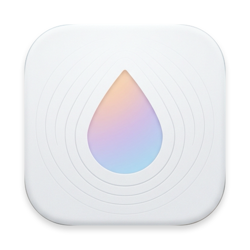
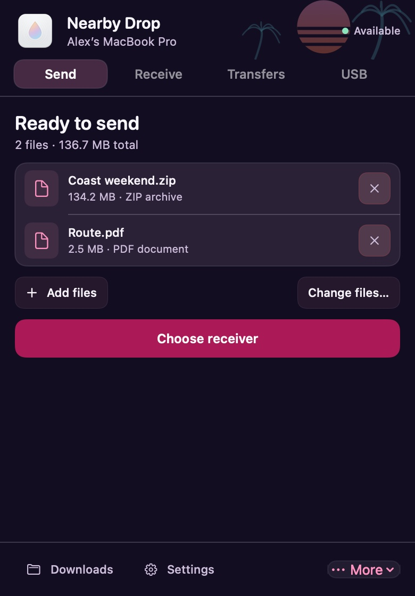
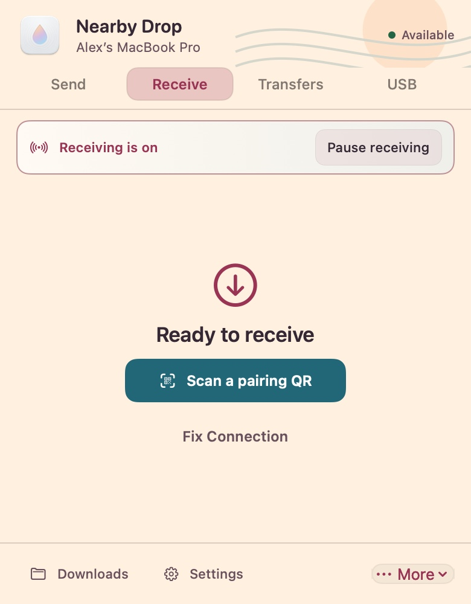
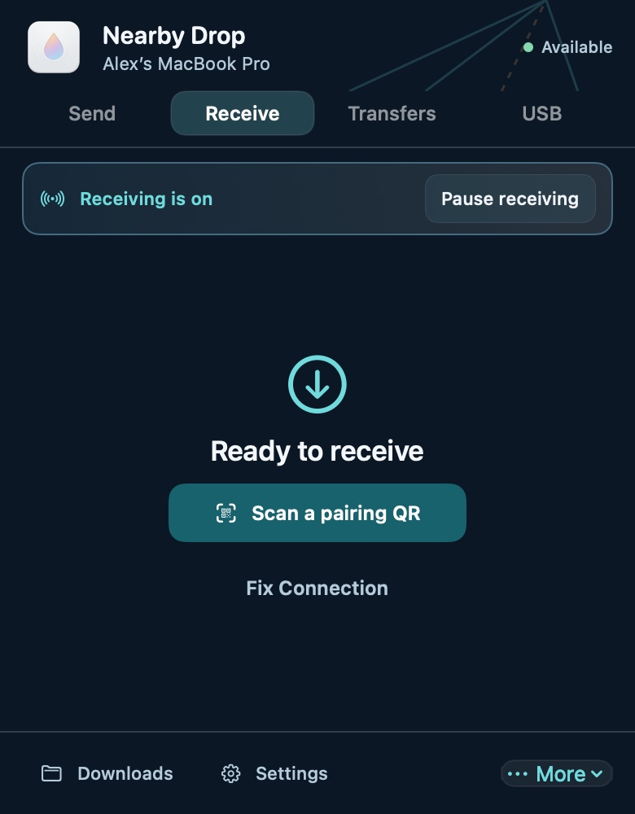

<h1 align="center">Nearby Drop</h1>

  
  
<strong>Quick Share between your Mac and Android.</strong> Wi-Fi, QR, or USB. Compatible Windows clients are supported too.

  

    <a href="https://github.com/arslanbasharat-o-o/NearByDrop/releases/latest"><strong>Download for Mac</strong></a> ·
    <a href="https://arslanbasharat-o-o.github.io/NearByDrop/">Website & setup</a> ·
    <a href="https://github.com/arslanbasharat-o-o/NearByDrop/releases">Release notes</a>
  

  

    
    
    
  

## New in 2.5

**Three original themes. More ways to share.**

<table>
  <tr>
    <td width="33%" align="center"><strong>Vice Nights</strong> Sunset pink &amp; ocean cyan </td>
    <td width="33%" align="center"><strong>Coastal Sunrise</strong> Warm cream &amp; tropical teal </td>
    <td width="33%" align="center"><strong>Midnight Route</strong> Deep navy &amp; clear cyan </td>
  </tr>
</table>

App previews use sample files and device names. System, Light and Dark remain available.

- **Connection Doctor:** local connection checks, with QR and USB next steps.
- **Text, links and screenshots:** prepare a UTF-8 text file or preview an image before choosing a receiver.
- **Favorite receivers:** quicker selection, with incoming approval still required.
- **USB tools:** filter and sort the current folder, clearer breadcrumbs and connection recovery.

[Explore the new themes and features](https://arslanbasharat-o-o.github.io/NearByDrop/#new-in-25) · [2.5 release notes](https://github.com/arslanbasharat-o-o/NearByDrop/releases/tag/v2.5.0)

Nearby Drop is an independent macOS menu bar app. It is not affiliated with Google or Apple.

## Install

Download the [latest DMG](https://github.com/arslanbasharat-o-o/NearByDrop/releases/latest), drag Nearby Drop to **Applications**, then open it. Requires **macOS 14 or newer**.

The app is ad hoc signed, not notarized. If macOS blocks it, open it once and approve it in **System Settings → Privacy & Security**. Keep Gatekeeper enabled.

## Send files

- **Android → Mac:** Put both devices on reachable Wi-Fi. Leave Nearby Drop on **Receive**, then select this Mac in Quick Share and accept the transfer. Scan a QR code if discovery fails.
- **Mac → Android:** In **Send**, choose files and select the Android device. Accept on the phone.
- **USB:** Unlock the phone, choose **File transfer**, connect a data cable, then use the **USB** tab.

Nearby Drop also supports Finder sharing, transfer history, and signed in-app updates. Windows Quick Share was tested with one PC; see the [device verification record](docs/DEVICE-VERIFICATION.md).

## Details and limits

Text and links arrive as clearly labeled UTF-8 .txt files. Native Quick Share text/link payload interoperability is not claimed. Screenshot capture needs explicit user action, macOS permission and review. Favorites are local name/type hints, not authenticated identities.

Wireless selections remain limited to 128 files; large-batch execution is disabled. See [candidate help](docs/upgrade/HELP.md), [diagnostics details](docs/upgrade/ANALYTICS.md) and [batch limits](docs/upgrade/EXPERIMENTAL-BATCHES.md).

Nearby Drop is independent and is not affiliated with Google, Apple or Rockstar Games.

## Privacy

Wireless transfers go directly over your local network; Nearby Drop does not relay files through its own cloud service. Every incoming transfer requires your approval, including QR-paired devices. Version 2.5 sends diagnostic reports automatically after setup and offers no in-app off switch. Older public versions may still have reporting controls. They include first launch and app opens (hour-rounded), a random installation ID, app and macOS versions, Mac hardware model, your Mac's advertised name, and the other device's advertised name and broad type after a successful wireless transfer. They never include file names, file contents, or device IDs. See the [privacy policy](https://arslanbasharat-o-o.github.io/NearByDrop/legal/privacy.html).

## Help

[Setup and FAQs](https://arslanbasharat-o-o.github.io/NearByDrop/) ·
[Report a bug](https://github.com/arslanbasharat-o-o/NearByDrop/issues) ·
[Security policy](SECURITY.md)

When reporting a bug, include the app and macOS versions, Mac type, phone model, and connection method. Do not post personal files, credentials, or active pairing codes.

## Project

[Contributing](CONTRIBUTING.md) · [Protocol notes](PROTOCOL.md) · [License](LICENSE) · [Third-party notices](Vendor/USB/README.md)

Nearby Drop is proprietary software, free to download. Quick Share is a Google trademark.
